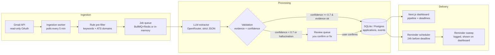

# JobRadar architecture

One email's journey: Gmail, then the worker, a cheap filter, a queue, LLM extraction, validation, the database, and finally the dashboard and reminders. Low-confidence mail goes to a review queue instead of the dashboard, and a reminder is only built for a validated deadline.

## The pipeline

## Why each boundary exists

| Boundary | Reason |
|---|---|
| Rule pre-filter before the LLM | Most inbox mail isn't job-related. Rules are free, the LLM isn't, so reject the obvious noise first. |
| Queue between fetch and extract | Retries and a concurrency cap so a burst never hammers the LLM. With Redis it's also crash-durable; in-memory mode trades that for zero-install local dev. |
| Validation between LLM and DB | The LLM can hallucinate a deadline. Nothing reaches the dashboard until the deadline text is found word-for-word in the email and the confidence clears the bar. |
| Review queue | Low-confidence mail becomes a human decision instead of a silent wrong answer, and each correction can become a future test fixture. |
| Reminder only for validated deadlines | We never nag about a date we aren't sure about. |
